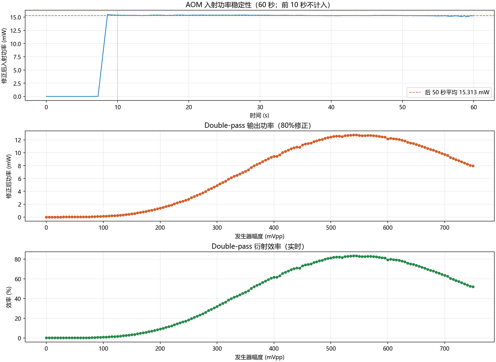

# 功率计 80% 修正版：AOM 双程衍射效率扫描

此版本按功率计读数为实际功率的 80% 估算：**入射功率和输出功率均为读数 ÷ 0.80**。两者用同一修正系数时，效率为两者之比，系数相消；不再对效率额外乘 1.25。修正的准确性取决于实际响应比例是否为 80%。

程序：[simple_app_corrected80.py](../../simple_app_corrected80.py)；启动：[start_gui_corrected80.cmd](../../start_gui_corrected80.cmd)。

## 测量方法

556 nm，RIGOL DG5352 Pro CH1 固定 100 MHz，经功放驱动 AOM；Thorlabs PM100D3 测量。先测入射光 60 秒，前 10 秒放置探头、后 50 秒均值作为入射参考。点击开始扫描并确认后，先等待 **5 秒**放置探头，然后自动测量；每点采样 5 次取平均。当前程序默认 **750 → 0 mVpp**，步长可改，顺序从大到小。

0 mVpp 时 RF 关闭，读数为残光；程序不自动扣除暗功率。750 mVpp 是程序可设上限，不代表已确认 AOM 或功放的额定允许值。

## 2026-11-05：750 → 0 mVpp

- 实际扫描 **151 点**，步长 **5 mVpp**；入射参考 **15.313035 mW**（已按 80% 修正）。
- 本次扫描最高记录 **83.36%（545 mVpp）**，该点修正后双程功率 **12.7646 mW**。
- [本次扫描 CSV](../../measurements/20261105_163300_double_pass_scan_corrected80.csv) · [入射功率记录 CSV](../../measurements/20261105_163231_incident_60s_corrected80.csv) · [功率及效率曲线](../../measurements/20261105_163300_double_pass_scan_corrected80.png)

## 2026-11-05：先前的 0 → 550 mVpp 测量

111 点，步长 5 mVpp，入射参考 **15.518445 mW**。550 mVpp 处记录 **84.61%**；这个数值位于本次扫描边界。

- [扫描 CSV](../../measurements/20261105_162105_double_pass_scan_corrected80.csv) · [曲线](../../measurements/20261105_162105_double_pass_scan_corrected80.png) · [采用的入射记录](../../measurements/20261105_144821_incident_60s_corrected80.csv)
- [另一份入射功率记录](../../measurements/20261105_144644_incident_60s_corrected80.csv)。

CSV 同时保存原始功率计读数、修正后功率和修正系数；效率按对应入射参考计算。
